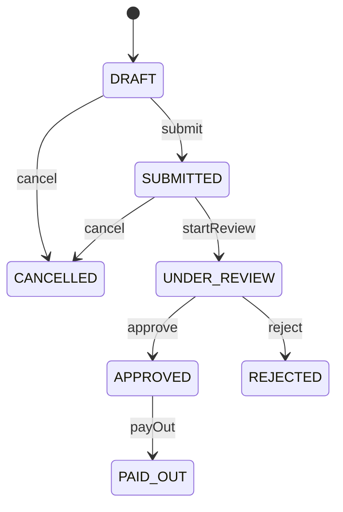

# Test Design Techniques → Code · Loan Application

     

The black-box techniques from the **ISTQB CTFL v4.0** syllabus, applied to one specification.
Each test case is first designed in a table, then written as a JUnit 5 parameterized test.
Part of my 52-week QA Automation roadmap — **Week 4**.

| CTFL v4.0 | Technique | Rule | Tests |
|---|---|---|---|
| 4.2.1 | Equivalence Partitioning | R1, R3 | 5 + 10 |
| 4.2.2 | Boundary Value Analysis (2- and 3-value) | R1, R2, R3 | 19 |
| 4.2.3 | Decision Table Testing | R4 | 11 |
| 4.2.4 | State Transition Testing | R5 | 45 |
| — | SQL data validation | R2, R4 | 7 |

## Specification

| Rule | Description |
|---|---|
| **R1 Age** | 18–70 inclusive is eligible. 0–17 and 71–120 are not. Below 0 or above 120 is invalid input. |
| **R2 Amount** | 1,000 € – 50,000 € inclusive. |
| **R3 Interest** | Score 300–579 → no loan · 580–669 → 12 % · 670–739 → 9 % · 740–850 → 6 % · outside 300–850 → invalid. |
| **R4 Decision** | Previous default → REJECT. Score < 580 → REJECT. Score ≥ 580 and income ≥ 2,000 € → APPROVE, otherwise MANUAL_REVIEW. |
| **R5 Status** | See the state diagram below. Every other transition is an error. |

## 1 · Equivalence Partitioning — R1 Age

| Partition | Range | Value | Expected |
|---|---|---|---|
| EP1 invalid (low) | < 0 | -1 | `IllegalArgumentException` |
| EP2 under age | 0–17 | 10 | not eligible |
| EP3 **valid** | 18–70 | 40 | eligible |
| EP4 over age | 71–120 | 90 | not eligible |
| EP5 invalid (high) | > 120 | 150 | `IllegalArgumentException` |

## 2 · Boundary Value Analysis

| Rule | Boundary | 3-value BVA |
|---|---|---|
| R1 Age | 18 / 70 | 17, 18, 19 · 69, 70, 71 |
| R2 Amount | 1,000 / 50,000 | 999, 1,000, 1,001 · 49,999, 50,000, 50,001 (+ 999.99 and 50,000.01) |
| R3 Score | 300 / 580 / 670 / 740 / 850 | 2-value: 299, 300 · 579, 580 · 669, 670 · 739, 740 · 850, 851 |

> **Experiment:** changing `age >= MIN_AGE` to `age > MIN_AGE` turns exactly **one** test red: the BVA case `age = 18`. All EP tests stay green. This is why BVA is a separate technique.

## 3 · Decision Table — R4

| | K1 | K2 | K3 | K4 | K5 | K6 | K7 | K8 |
|---|---|---|---|---|---|---|---|---|
| C1 Previous default | Y | Y | Y | Y | N | N | N | N |
| C2 Score ≥ 580 | Y | Y | N | N | Y | Y | N | N |
| C3 Income ≥ 2,000 | Y | N | Y | N | Y | N | Y | N |
| **Decision** | REJECT | REJECT | REJECT | REJECT | **APPROVE** | **MANUAL** | REJECT | REJECT |

All 8 rules are tested, plus the exact boundaries of C2 and C3 (579 / 580, 1,999.99 / 2,000).

## 4 · State Transition — R5



- **7 valid transitions** → all-transitions coverage
- **35 invalid transitions** (7 states × 6 events − 7), generated with `@MethodSource`. Each one must throw **and** leave the state unchanged.
- Tests reach each state through real events only, never by setting the state directly.

> **Experiment:** adding an unspecified transition `REJECTED --submit--> SUBMITTED` keeps every valid-path test green. Only the invalid-transition test catches it. Bugs like "the code allows something the spec does not" are found only when invalid transitions are tested too.

## 5 · SQL data validation (H2 in-memory)

Each test gets its own fresh in-memory database (`jdbc:h2:mem:<uuid>`) loaded from `schema.sql` and `data.sql`.

| Query | SQL |
|---|---|
| Applications by status | `WHERE`, `ORDER BY` |
| Count per status | `GROUP BY`, `COUNT` |
| Total approved amount | `SUM`, `COALESCE` |
| Customers with more than one application | `JOIN`, `GROUP BY`, `HAVING` |
| Top 3 amounts | `ORDER BY … DESC`, `LIMIT` |
| **Integrity:** approved although score < 580 | `JOIN` + business rule R4 |
| **Integrity:** amount outside 1,000–50,000 | `NOT BETWEEN` + business rule R2 |

The seed data contains **two intentionally broken records** (104 and 107). The integrity tests find them.
All queries use `PreparedStatement` parameters, which protect against SQL injection.

## Run

```bash
mvn clean test
```

```
Tests run: 97, Failures: 0, Errors: 0, Skipped: 0
BUILD SUCCESS
```

## What I learned
- _TODO: 2–3 sentences in your own words_